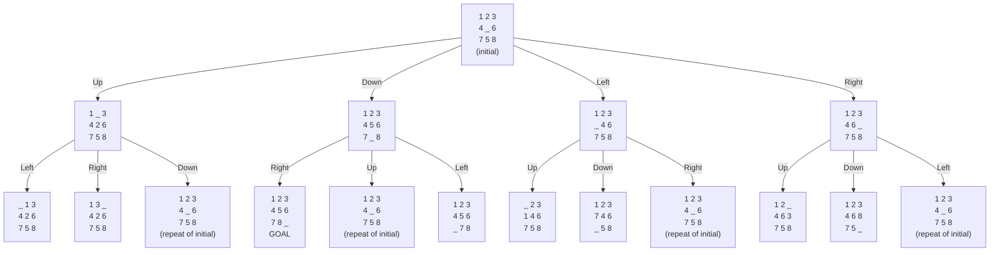
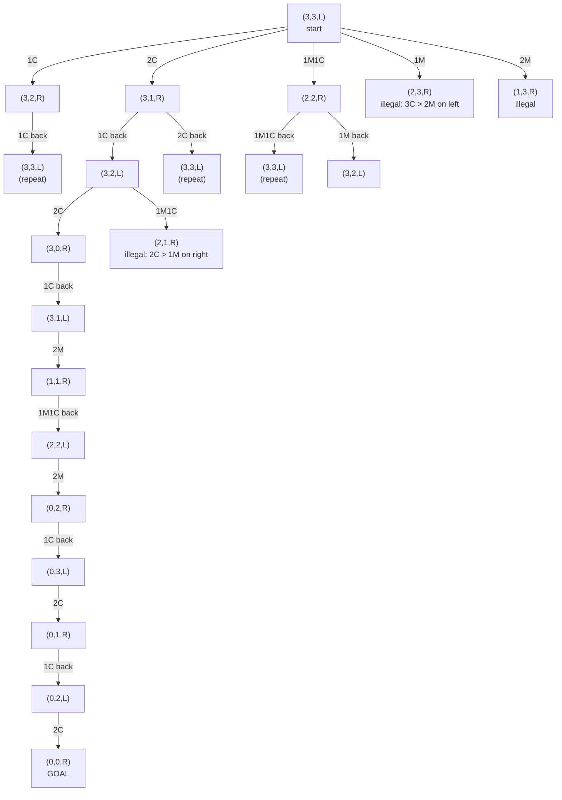
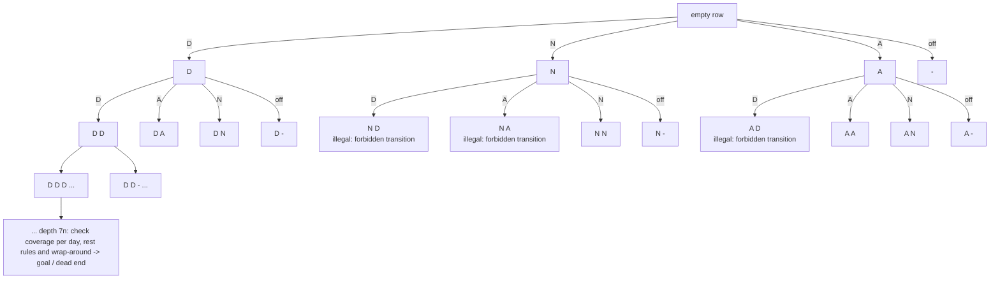

# Search Trees (Task 4)

Each tree is drawn with Mermaid (GitHub renders it directly). Nodes are states,
edges are actions. Only the first levels are drawn; repeated states are marked.

---

## 1. 8-Puzzle

**State:** 3x3 board, `_` is the blank. **Actions:** move the blank Up / Down / Left / Right.
**Goal:** `1 2 3 / 4 5 6 / 7 8 _`. **Step cost:** 1.
**Branching factor:** 2 (corner blank), 3 (edge blank), 4 (centre blank); about 2.67 on average.
**State space:** 9!/2 = 181 440 reachable states.

Worst-case nodes for depth d (b ~ 3, no repeated-state check): about 3^d.
With a closed list the tree is bounded by the 181 440 states.

---

## 2. Missionaries and Cannibals

**State:** `(M, C, B)` = missionaries and cannibals on the **left** bank, boat side `B` (L/R). Start `(3,3,L)`, goal `(0,0,R)`.
**Actions:** the boat carries 1 or 2 people: `1M`, `2M`, `1C`, `2C`, `1M1C`.
**Constraint:** on neither bank may cannibals outnumber missionaries (if missionaries are present). Illegal states are pruned.

The long branch `(3,3,L) -> (3,1,R) -> (3,2,L) -> (3,0,R) -> ... -> (0,0,R)` is the shortest solution (11 crossings).
State space: 4 x 4 x 2 = 32 combinations, 16 of them legal; branching factor <= 5.

---

## 3. Rotating Workforce Scheduling

**Problem:** build a cyclic schedule for `n` employees over a cycle of `n` weeks (`7n` days). Each day has a shift from
`{D (day), A (afternoon), N (night), - (off)}`; each day needs the required number of staff per shift, the number of working
days in a row, free days in a row, allowed shift transitions (e.g. N must not be followed by D) and the schedule must wrap around
(the last day connects to the first).

**State:** the sequence of shifts assigned to the days `1..k` of one employee's row (the other employees use the same row shifted by one week, which is what makes it "rotating").
**Action:** assign a shift to day `k+1`.
**Branching factor:** 4 (D, A, N, off), reduced by the constraints.
**Search space:** 4^(7n) rows, for example 4^21 ~ 4.4e12 for `n = 3`.

Example with three weeks (`n = 3`), first levels of the tree for the first days of the row:

Nodes at depth `k` that violate a transition or max-consecutive rule are pruned (backtracking); a leaf at depth `7n` is a goal only if the daily
coverage requirement is met and the last day connects legally to the first.
